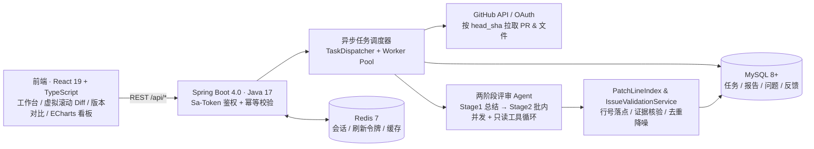

<div align="center">

# AI PR Review

**面向开发者的 GitHub Pull Request 智能代码评审平台**

*Full-Stack AI Code Review Platform with Two-Stage Tool-Calling Agent, Line-Level Evidence Verification & Interactive Diff Workspace*


</div>

---

## 项目简介

**AI PR Review** 是一个全栈式 GitHub Pull Request 智能评审平台。输入任意公开 PR 链接，系统异步完成**分层变更总结、重点文件排序、跨文件只读上下文检索、7 类风险缺陷识别与代码行号/证据强校验**，并输出可交互 Diff 定位、多版本对比、人工反馈闭环与 Markdown 导出报告。

---

## 核心特性

### 两阶段 Agent 评审与防幻觉校验
- **分层总结与重点阅读（Stage 1）**：结合 PR 元数据、Commit 与文件清单生成整体目标、核心变更、影响模块与单文件摘要，按风险自动标注重点审查文件。
- **跨文件只读工具循环（Stage 2）**：针对 TypeScript / Python 自动提取变更所在函数与 `import` 上下文，Agent 可通过只读工具（`read_file`、`find_callers`、`read_tests`）按固定 `head_sha` 补充跨文件依赖，无 Shell/任意网络风险，并隔离代码注释中的 Prompt 注入。
- **严格行号与证据校验（Anti-Hallucination）**：`IssueValidationService` 与 `PatchLineIndex` 强校验文件归属、新增行号命中与证据完整度；无法定位的候选问题自动丢弃或降级，结合去重与置信度分级显著降低误报。
- **大 PR 批内并发与容错恢复**：支持有界线程池与批内并发（187 文件大 PR 耗时由 **137.6s 降至 60.1s**，无 OOM）；单批异常不影响已完成结果（状态落为「部分完成」），服务重启自动识别僵死任务并支持幂等重试。

### 完整交互工作台与企业级底座
- **现代前端体验**：基于 React 19 + TypeScript + `@tanstack/react-virtual` 实现高性能可交互代码 Diff 查看器、实时任务进度工作台、同一 PR 多轮版本对比（`added / remaining / resolved`）、ECharts 数据分析看板、中英文 i18n、明暗主题切换与新手引导。
- **账号、权限与多模型治理**：集成 Sa-Token + Redis 双 Token（Refresh 旋转）、BCrypt、GitHub OAuth 登录与用户级 Token 绑定；支持管理员配置 OpenAI 兼容 / Anthropic 双协议多模型与用户偏好切换，密钥 AES-GCM 加密存储且全链路日志脱敏。
- **无 Key 本地确定性联调**：内置 `pr.ai.provider=fake` 确定性模拟引擎与完整 Playwright 浏览器联调套件，无模型密钥亦可一键跑通全链路。

---

## 系统架构



---

## 快速开始

### 1. 启动后端服务

```bash
# 1. 启动 MySQL 与 Redis，创建数据库并导入 deploy/sql/schema.sql
# 2. 复制 backend/src/main/resources/application-dev.yml.example 为 application-dev.yml 并填写配置
cd backend
./mvnw -q -DskipTests package
java -jar target/backend-0.0.1-SNAPSHOT.jar --server.port=8080
```

> 无模型 Key 时可通过 `--pr.ai.provider=fake` 启动确定性本地联调模式；Swagger 接口文档位于 `http://localhost:8080/swagger-ui.html`。

### 2. 启动前端服务

```bash
cd frontend
npm ci
npm run dev       # http://localhost:5173（/api 自动代理至 8080）
```

> 本地演示种子账号：`demo / demo123`。运行 `npm run test:integration` 可执行 Playwright 真实接口端到端联调测试。

### 3. Docker Compose 部署

生产与容器化部署（含 Nginx 子路径反代、环境变量模板与安全清单）请查看 [`deploy/README.md`](deploy/README.md)。

---

## 目录结构

```text
ai-pr-review/
├── backend/        # Spring Boot 4.0 后端（Java 17、MyBatis-Plus、Sa-Token、两阶段 Agent 管线）
├── frontend/       # React 19 + TypeScript + Vite 8 前端工作台与 Playwright E2E / 联调测试
├── deploy/         # Dockerfile、Docker Compose、Nginx 反代配置与 SQL 初始化脚本
└── docs/           # 架构设计、接口契约、模型对比、测试用例与实测指标文档
```

---

## 文档导航

| 文档 | 内容说明 |
| :--- | :--- |
| [docs/README.md](docs/README.md) | 全部项目文档索引与阅读路径 |
| [非平凡需求设计说明](docs/非平凡需求设计说明.md) | 任务状态机、版本一致性、跨文件上下文、校验降噪与并发容错设计 |
| [测试用例与指标](docs/测试用例与指标.md) | 20 项核心用例验证、真实跨文件 PR 检出率/定位率与 187 文件大 Diff 并发实测 |
| [模型对比与选型](docs/模型对比与选型.md) | 多模型在真实 PR 样本上的质量、耗时与成本对比 |
| [接口文档](docs/接口文档.md) / [数据库表设计](docs/数据库表设计.md) | RESTful 接口契约与 MySQL 表结构说明 |
| [部署与安全检查](docs/部署与安全检查.md) | 密钥管理、日志脱敏、TLS 终止与上线核查清单 |

---

## 安全说明

- 真实数据库密码、GitHub Token 与模型 API Key 仅通过本地 `application-dev.yml`、环境变量或 `deploy/.env` 注入，绝不提交至代码仓库。
- 日志链路默认脱敏，不输出完整 Prompt、源代码全文或访问令牌；生产环境需替换默认初始化密码并由外部网关 / Nginx 终止 TLS。
