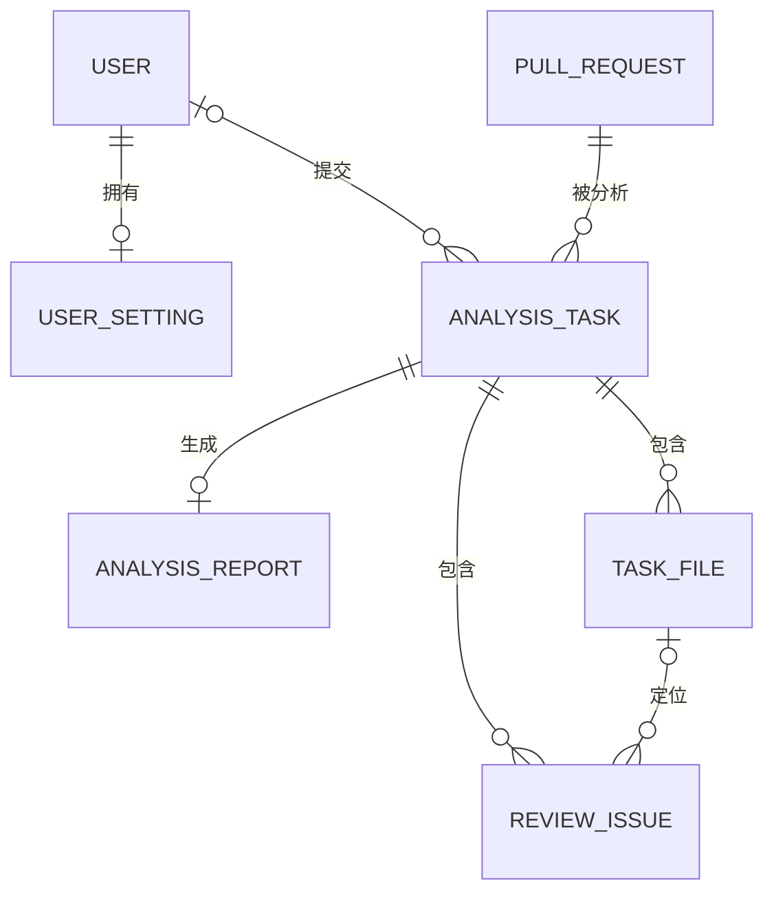

# AI PR Review 平台数据库表设计

> **当前后端骨架实现说明（2026-10-21）**
>
> 通用登录/用户管理骨架使用 `sys_user` 表（`username`、`password`、`nickname`、`role`、`status` 等字段），建表脚本在 `backend/src/main/resources/db/schema.sql`。
> 本文的 `user` 表是完整业务设计中的邮箱账号模型；后续接入完整业务时，可在 `user` 与 `sys_user` 之间做映射迁移，或统一为其中一套模型。

> 数据库：MySQL 8.x，InnoDB，`utf8mb4_0900_ai_ci`。库名沿用 `application-dev.yml` 里的 `ai-pr-review`。
> 初始化脚本：`deploy/sql/schema.sql`，本文第 8 节同步贴出。
> 接口设计：`docs/接口文档.md`。

## 1. 设计目标

这次没有按"用户、任务、报告、问题、反馈、设置"逐项建表，而是先按数据的生命周期归并：

- 用户和设置是一对一的稳定数据，放两张表，读设置时不碰密码字段。
- PR 元数据被同一 PR 的多次分析共用，单独一张 `pull_request`。
- 每次分析绑定一个提交版本，用 `analysis_task` 作为版本边界。报告、文件、问题全部挂 `task_id`，从库结构上保证 B01 的版本一致性。
- 大文本按访问场景拆开：报告总结只在工作台打开时读，Diff 只在按文件加载时读，任务列表不碰这些字段。
- 人工反馈不另建历史表。一个问题的最终处理状态、理由和编辑后的建议都放在 `review_issue`，撤销就是改回字段，不额外维护流水。

最终是 7 张表：

| 表 | 回答的问题 |
| --- | --- |
| `user` | 谁在平台上有账号 |
| `user_setting` | 这个人的主题、语言和分析偏好 |
| `pull_request` | 是哪个仓库的哪个 PR，最新提交是什么 |
| `analysis_task` | 哪个人在哪个版本上发起了一次分析，执行到哪一步 |
| `analysis_report` | 这次分析对 PR 的整体结论 |
| `task_file` | 这个版本改了哪些文件，文件级结论和 Diff 是什么 |
| `review_issue` | 发现了哪些候选问题，人工怎么处理 |

### 1.1 命名和类型约定

按项目里常见的写法来，不追求花哨：

- 表名单数：`user`、`pull_request`、`analysis_task`，不用复数。
- 字段全部下划线命名，外键用 `user_id`、`pr_id`、`task_id`、`file_id`。
- 审计字段统一 `create_time`、`update_time`，不用 `created_at` / `updated_at`。
- 布尔语义用 `is_` 前缀：`is_deleted`、`is_binary`。
- 状态、阶段、类型用 `TINYINT` 存编码，含义写在字段注释里，Java 侧用常量或枚举对应。比直接存中文或 ENUM 更省空间，也避免以后加状态时改表。
- 主键统一 `BIGINT AUTO_INCREMENT`；时间用 `DATETIME`；金额类字段本项目没有，不需要 `DECIMAL`。
- 短文本用 `VARCHAR`，长文本用 `TEXT`，Diff 用 `MEDIUMTEXT`，配置快照用 `JSON`。

### 1.2 字段取舍原则

- 能稳定推导的不存：变更总行数 = `add_lines + delete_lines`；覆盖率 = 按 `task_file.status` 聚合；报告里的文件数、跳过数不单独建列。
- 只在运行时用、不进入报告的不存：PR 描述、commit message、完整的函数上下文。这些拉取后直接参与分析，报告只保存结论。
- 不为"以后可能用"预留字段：没有 `role`、`avatar`、`github_id`、`retry_count`、`fingerprint`。等真正做私有仓库、增量评审时再加表或加列。
- 需要保留编辑前内容的字段才存两份：`review_issue.ai_suggestion` 和 `suggestion`。其余人工操作只保留最终状态。

## 2. ER 关系



关系说明：

- `user` 与 `user_setting` 一对一。游客没有用户行，游客任务直接 `user_id = NULL`。
- `user` 与 `analysis_task` 是一对多，但任务侧允许为空：登录用户的任务有 `user_id`，游客任务只有 `guest_token`。
- `pull_request` 与 `analysis_task` 是一对多。同一个 PR 可以因为新提交、重试、不同用户而产生多条任务。
- `analysis_task` 与 `analysis_report` 一对一。失败或取消的任务可以没有报告。
- `analysis_task` 与 `task_file`、`review_issue` 都是一对多。两者的 `task_id` 是版本一致性的关键。
- `task_file` 与 `review_issue` 是一对多。报告级提示不定位到具体文件，`file_id` 为空。

## 3. 状态码与枚举

状态、阶段、类型编码都从 1 开始，0 只留给布尔假值，避免和 `NULL` 混在一起；置信度、进度这类数值字段按实际范围取值。

| 字段 | 取值 | 含义 |
| --- | --- | --- |
| `analysis_task.status` | 1 / 2 / 3 / 4 / 5 / 6 | 排队 / 分析中 / 已完成 / 部分完成 / 失败 / 已取消 |
| `analysis_task.stage` | 1–7 | 排队 / 获取 PR / 获取变更 / 补充上下文 / AI 分析 / 校验入库 / 结束 |
| `pull_request.state` | 1 / 2 / 3 | open / closed / merged |
| `task_file.change_type` | 1 / 2 / 3 / 4 / 5 | 新增 / 修改 / 删除 / 重命名 / 复制 |
| `task_file.status` | 1 / 2 / 3 / 4 | 待分析 / 已分析 / 已跳过 / 分析失败 |
| `review_issue.category` | 1–7 | 逻辑错误 / 空值与边界 / 异常处理 / 权限与敏感信息 / 接口与数据兼容 / 缺失测试 / 其他 |
| `review_issue.severity` | 1 / 2 / 3 / 4 | 低 / 中 / 高 / 严重 |
| `review_issue.feedback_status` | 1 / 2 / 3 / 4 | 待确认 / 已采纳 / 已解决 / 误报 |
| `analysis_task.error_code` | 1–8 | PR 无效 / GitHub 限流 / 无仓库权限 / GitHub 请求失败 / Diff 过大 / 模型超时 / 模型输出格式错误 / 内部错误 |
| `user_setting.theme` | 1 / 2 / 3 | 浅色 / 深色 / 跟随系统 |
| `language`、`report_language` | `zh-CN` / `en-US` | 简体中文 / 英文 |

补充约定：

- `stage` 在失败或取消时停留在出错阶段，不强制改成"结束"。这样看任务详情时能知道失败发生在获取变更还是模型调用。
- `status = 4`（部分完成）表示有文件被跳过或部分阶段失败，但已经产出了可用结果。只要有跳过文件，就不标成 3。
- `error_code` 只在失败或部分完成时填写；`error_message` 是脱敏后的摘要，不写堆栈、令牌和完整代码。

## 4. 表结构

### 4.1 `user` 用户

只存登录必需的信息。平台只有一类使用者，不做角色、权限、头像、手机号这些当前用不到的资料。

| 字段 | 类型 | 允许空 | 默认值 | 说明 |
| --- | --- | --- | --- | --- |
| `id` | BIGINT | 否 | 自增 | 主键 |
| `email` | VARCHAR(255) | 否 | — | 登录邮箱，全局唯一 |
| `password` | VARCHAR(100) | 否 | — | BCrypt 加密后的密码，不存明文 |
| `name` | VARCHAR(64) | 否 | — | 昵称，注册时默认取邮箱前缀 |
| `is_deleted` | TINYINT | 否 | 0 | 0 正常，1 已注销 |
| `create_time` | DATETIME | 否 | 当前时间 | 创建时间 |
| `update_time` | DATETIME | 否 | 当前时间 | 更新时间，自动维护 |

索引与约束：

- `PRIMARY KEY (id)`
- `UNIQUE KEY uk_email (email)`

说明：

- F18 只要求至少一种登录方式，这里选邮箱密码，字段不再为 GitHub OAuth 预留。以后接 GitHub 授权时再加 `github_id` 或独立的第三方绑定表，避免现在放一堆空字段。
- 注销采用逻辑删除。邮箱继续占位，不允许同邮箱重新注册；如果以后需要释放邮箱，可以在注销时把 `email` 改成 `deleted_{id}@invalid.local`，这属于业务处理，不需要加字段。
- 登录失败次数、验证码、会话都放 Redis，不进用户表。

### 4.2 `user_setting` 用户设置

和用户一对一，主键直接用 `user_id`，不额外造一个设置 ID。

| 字段 | 类型 | 允许空 | 默认值 | 说明 |
| --- | --- | --- | --- | --- |
| `user_id` | BIGINT | 否 | — | 主键，关联 `user.id` |
| `theme` | TINYINT | 否 | 3 | 1 浅色，2 深色，3 跟随系统 |
| `language` | VARCHAR(10) | 否 | `zh-CN` | 界面语言：`zh-CN` / `en-US` |
| `check_categories` | VARCHAR(200) | 否 | `1,2,3,4,5,6` | 重点检查类别，逗号分隔，编码见第 3 节 |
| `ignore_dirs` | VARCHAR(1000) | 否 | `node_modules,dist,target,.git` | 分析时忽略的目录，逗号分隔 |
| `max_file_count` | INT | 否 | 200 | 单次分析最多纳入多少个文件 |
| `max_diff_lines` | INT | 否 | 20000 | 单次分析最多处理多少行 Diff |
| `create_time` | DATETIME | 否 | 当前时间 | 创建时间 |
| `update_time` | DATETIME | 否 | 当前时间 | 更新时间，自动维护 |

索引与约束：

- `PRIMARY KEY (user_id)`
- `fk_setting_user`：`user_id` → `user.id`，`ON DELETE CASCADE`

说明：

- 主题和界面语言存在这里，游客则用浏览器 `localStorage`，登录后以服务端为准。F25/F26 的"下次访问恢复"两种场景都能覆盖。
- `check_categories` 和 `ignore_dirs` 用逗号分隔的短文本，没有上 JSON。它们只在创建任务时读一次，没必要为了两个数组增加类型处理器。
- `max_file_count`、`max_diff_lines` 是分析规模上限；超出的文件在 `task_file` 里标记为跳过并写明原因，不直接丢弃。
- 注册时插入一行默认设置，后续更新走同一行。没有设置行时按默认值处理也可以，不强制外键之外的额外逻辑。
- 报告语言不放在这里。F27 是按每次分析选择的，放在 `analysis_task.report_language`，历史报告才不会因为用户后来切换界面语言而被改写。

### 4.3 `pull_request` PR 元数据

同一个仓库的同一个 PR 只存一行，作为最新状态的缓存。每次分析任务再保存自己的 `head_sha` 快照。

| 字段 | 类型 | 允许空 | 默认值 | 说明 |
| --- | --- | --- | --- | --- |
| `id` | BIGINT | 否 | 自增 | 主键 |
| `repo_full_name` | VARCHAR(150) | 否 | — | 仓库全名，`owner/repo` |
| `pr_number` | INT | 否 | — | PR 编号 |
| `title` | VARCHAR(300) | 否 | — | PR 标题 |
| `author` | VARCHAR(64) | 否 | — | PR 作者的 GitHub 用户名 |
| `state` | TINYINT | 否 | 1 | 1 open，2 closed，3 merged |
| `base_branch` | VARCHAR(255) | 否 | — | 目标分支 |
| `head_branch` | VARCHAR(255) | 否 | — | 来源分支 |
| `head_sha` | CHAR(40) | 否 | — | 当前最新 head commit SHA |
| `add_lines` | INT | 否 | 0 | 新增行数 |
| `delete_lines` | INT | 否 | 0 | 删除行数 |
| `file_count` | INT | 否 | 0 | 变更文件数 |
| `create_time` | DATETIME | 否 | 当前时间 | 首次入库时间 |
| `update_time` | DATETIME | 否 | 当前时间 | 最近同步时间，自动维护 |

索引与约束：

- `PRIMARY KEY (id)`
- `UNIQUE KEY uk_repo_pr (repo_full_name, pr_number)`

说明：

- `head_sha` 会被 PR 新提交覆盖，任务表里的 `head_sha` 不跟着变。F04 判断报告是否过期，就是比较 `pull_request.head_sha` 和 `analysis_task.head_sha`。
- 过期判断依赖 `pull_request.head_sha` 及时更新。打开旧任务时重新拉一次 PR 元数据，或者由后台定时同步，不能假设这张表永远是最新的。
- `add_lines`、`delete_lines`、`file_count` 来自 GitHub 的 PR 统计，用于首页和总览展示。它们和任务版本可能不一致，只作为 PR 当前概况；具体版本的统计以 `task_file` 汇总为准。
- 不存 PR 描述和 commit message。这两类内容主要给模型做输入，拉取后即可使用；报告里保存的是分析结论，历史回看也不依赖原文。这样避免在 PR 表里塞大文本。
- `repo_full_name` 的排序规则不区分大小写，符合 GitHub 仓库名不区分大小写的实际行为。

### 4.4 `analysis_task` 分析任务

核心表。一次分析 = 一个 `pr_id` + 一个 `head_sha` + 一个发起人（或游客令牌）。报告、文件、问题都挂在这条任务下。

| 字段 | 类型 | 允许空 | 默认值 | 说明 |
| --- | --- | --- | --- | --- |
| `id` | BIGINT | 否 | 自增 | 主键 |
| `pr_id` | BIGINT | 否 | — | 关联 `pull_request.id` |
| `user_id` | BIGINT | 是 | NULL | 发起用户；游客任务为空 |
| `head_sha` | CHAR(40) | 否 | — | 本次分析对应的 head commit SHA |
| `report_language` | VARCHAR(10) | 否 | `zh-CN` | 本次报告语言 |
| `status` | TINYINT | 否 | 1 | 任务状态，见第 3 节 |
| `stage` | TINYINT | 否 | 1 | 当前阶段，见第 3 节 |
| `progress` | TINYINT | 否 | 0 | 进度，0–100 |
| `model_name` | VARCHAR(64) | 是 | NULL | 本次使用的模型名称 |
| `analysis_config` | JSON | 是 | NULL | 本次使用的非敏感配置快照 |
| `error_code` | TINYINT | 是 | NULL | 失败或部分完成的原因编码，正常为空 |
| `error_message` | VARCHAR(500) | 是 | NULL | 失败或部分完成的原因摘要，已脱敏 |
| `guest_token` | VARCHAR(64) | 是 | NULL | 游客访问令牌，32 字节随机数的十六进制串，登录用户为空 |
| `expire_time` | DATETIME | 是 | NULL | 游客任务过期时间，登录用户为空 |
| `start_time` | DATETIME | 是 | NULL | 开始执行时间 |
| `finish_time` | DATETIME | 是 | NULL | 结束时间 |
| `is_deleted` | TINYINT | 否 | 0 | 0 正常，1 已删除 |
| `create_time` | DATETIME | 否 | 当前时间 | 创建时间 |
| `update_time` | DATETIME | 否 | 当前时间 | 更新时间，自动维护 |

`analysis_config` 示例：

```json
{
  "checkCategories": [1, 2, 3, 4, 5, 6],
  "ignoreDirs": ["node_modules", "dist", "target", ".git"],
  "maxFileCount": 200,
  "maxDiffLines": 20000
}
```

索引与约束：

- `PRIMARY KEY (id)`
- `UNIQUE KEY uk_guest_token (guest_token)`
- `KEY idx_user_time (user_id, create_time)`：登录用户的任务列表，按时间倒序。
- `KEY idx_user_pr_time (user_id, pr_id, create_time)`：历史页按仓库/PR 编号筛选，以及同一 PR 的版本列表。
- `KEY idx_pr_sha_user (pr_id, head_sha, user_id, status)`：同提交版本复用已有结果。
- `KEY idx_status (status)`：后台工作线程取排队任务。
- `KEY idx_expire_time (expire_time)`：清理过期游客任务。
- `fk_task_pr`：`pr_id` → `pull_request.id`，`ON DELETE RESTRICT`。
- `fk_task_user`：`user_id` → `user.id`，`ON DELETE RESTRICT`。

状态流转：

```text
1 排队 -> 2 分析中 -> 3 已完成
                  -> 4 部分完成
                  -> 5 失败
                  -> 6 已取消
```

- 取消只允许从 1 或 2 进入 6；进入 3/4/5/6 时写 `finish_time`。
- `progress` 随阶段推进更新；完成和部分完成置 100，失败和取消保留最后进度，方便看出停在哪一步。
- 重试不原地重置任务，而是新建一条任务。这样失败记录、旧报告和旧版本都还在，F15 的历史也完整。
- 同版本复用：查 `pr_id + head_sha + user_id` 下状态为 3 或 4 的最新任务；有就返回"可复用"提示，不阻止用户重新分析。
- `head_sha` 和 `pull_request.head_sha` 重复是有意的。PR 的 head 会前进，任务的 head 必须固定，否则报告、行号和文件都会对不上。
- 不存 `base_sha`。GitHub 的 PR files 接口按 PR 的合并基线返回 Diff，报告一致性只依赖 head SHA，多存一个基线 SHA 反而容易和实际 Diff 不一致。
- `guest_token` 用 32 字节随机数的十六进制串（64 字符），只在游客任务上生成。访问游客结果时必须同时校验令牌和 `expire_time`。
- `analysis_config` 记录创建任务时实际生效的配置，不记录模型密钥、GitHub Token 等敏感信息。F16 要求报告能说明本次分析的配置，读任务行即可。
- `model_name` 放在任务上而不是报告上，失败任务也能知道当时选的是哪个模型，便于 D02 的对比统计。

### 4.5 `analysis_report` 分析报告总结

一条任务最多一条报告，存 PR 级别的三层总结。

| 字段 | 类型 | 允许空 | 默认值 | 说明 |
| --- | --- | --- | --- | --- |
| `id` | BIGINT | 否 | 自增 | 主键 |
| `task_id` | BIGINT | 否 | — | 关联 `analysis_task.id`，唯一 |
| `purpose` | TEXT | 是 | NULL | PR 修改目的 |
| `changes` | TEXT | 是 | NULL | 主要变更 |
| `impacts` | TEXT | 是 | NULL | 可能影响的模块 |
| `create_time` | DATETIME | 否 | 当前时间 | 创建时间 |
| `update_time` | DATETIME | 否 | 当前时间 | 更新时间，自动维护 |

索引与约束：

- `PRIMARY KEY (id)`
- `UNIQUE KEY uk_task (task_id)`
- `fk_report_task`：`task_id` → `analysis_task.id`，`ON DELETE CASCADE`

说明：

- 三个字段允许为空，是为了部分完成。比如文件已经分析完、问题也入库了，但总结阶段模型超时，报告仍可展示已有问题，页面上把空的部分标成"未生成"，而不是伪造内容。
- 没有把总结塞进 `analysis_task`，是为了让任务列表查询保持窄表。报告只在打开工作台时读，任务列表不碰这三个 `TEXT`。
- 没有存覆盖文件数、跳过文件数。`task_file` 按 `task_id` 聚合一次就能得到，存冗余计数反而要在文件状态变化时同步更新。
- 文件级简述在 `task_file.summary`，不在这里拆成子表。一个文件一条简述，语义已经完整。
- 失败任务可以没有报告行；部分完成和已完成应该有报告行，哪怕某些字段为空。

### 4.6 `task_file` 任务变更文件

一次任务下的文件快照。每个文件一行，Diff 和文件级结论都放这里。

| 字段 | 类型 | 允许空 | 默认值 | 说明 |
| --- | --- | --- | --- | --- |
| `id` | BIGINT | 否 | 自增 | 主键 |
| `task_id` | BIGINT | 否 | — | 关联 `analysis_task.id` |
| `file_path` | VARCHAR(512) | 否 | — | 当前文件路径 |
| `old_path` | VARCHAR(512) | 是 | NULL | 重命名前的路径 |
| `change_type` | TINYINT | 否 | — | 1 新增，2 修改，3 删除，4 重命名，5 复制 |
| `add_lines` | INT | 否 | 0 | 新增行数 |
| `delete_lines` | INT | 否 | 0 | 删除行数 |
| `language` | VARCHAR(32) | 是 | NULL | 文件语言，如 `java`、`typescript`、`python` |
| `is_binary` | TINYINT | 否 | 0 | 0 否，1 是 |
| `patch` | MEDIUMTEXT | 是 | NULL | 文件 diff 片段；二进制或未返回时为空 |
| `status` | TINYINT | 否 | 1 | 1 待分析，2 已分析，3 已跳过，4 分析失败 |
| `skip_reason` | VARCHAR(500) | 是 | NULL | 跳过或失败原因 |
| `priority_reason` | VARCHAR(500) | 是 | NULL | 重点阅读原因；为空表示非重点文件 |
| `summary` | TEXT | 是 | NULL | 文件级变更简述 |
| `create_time` | DATETIME | 否 | 当前时间 | 创建时间 |
| `update_time` | DATETIME | 否 | 当前时间 | 更新时间，自动维护 |

索引与约束：

- `PRIMARY KEY (id)`
- `UNIQUE KEY uk_task_path (task_id, file_path)`
- `KEY idx_task_status (task_id, status)`：覆盖统计和按状态筛选。
- `fk_file_task`：`task_id` → `analysis_task.id`，`ON DELETE CASCADE`

说明：

- `file_path` 在同一个任务内唯一，避免模型或 GitHub 返回重复文件。
- `old_path` 只在重命名时有值，用来展示 `old_path -> file_path`，也方便 F22 跨版本按路径匹配。
- `language` 是从扩展名识别后落库的。F02 要展示语言，分析阶段也要按语言选上下文策略，存下来比每次查表推导省事。
- `patch` 是文件级 Diff，列表查询不选这一列，点开某个文件时再按 `id` 或 `(task_id, file_path)` 加载，避免一次任务把几 MB 文本全读出来。
- 二进制文件和 GitHub 未返回 patch 的文件，`patch` 为空，同时 `is_binary` 或 `skip_reason` 会说明原因。超过分析上限但 patch 已经拿到的文件仍保留 patch 供页面查看，用 `status = 3` 加 `skip_reason` 标识为跳过，不额外加 `is_truncated` 这类只有一个用途的布尔字段。
- 重点阅读用 `priority_reason` 一个字段表达：有值就是重点文件，值为空就不是。没有再放一个 `is_priority`，减少一个需要同步的字段。
- 文件级总结放 `summary`。没有单独建 `task_file_summary` 表，因为一个文件只有一条总结，拆表只会多一次 join。
- `status = 3` 不区分"用户忽略目录""二进制""超过分析上限"，具体原因写在 `skip_reason`；前端展示时按原因分类即可。

### 4.7 `review_issue` 评审问题与人工反馈

一条候选问题一行。人工处理状态和理由直接放在问题行上，不另建反馈表。

| 字段 | 类型 | 允许空 | 默认值 | 说明 |
| --- | --- | --- | --- | --- |
| `id` | BIGINT | 否 | 自增 | 主键 |
| `task_id` | BIGINT | 否 | — | 关联 `analysis_task.id` |
| `file_id` | BIGINT | 是 | NULL | 关联 `task_file.id`；报告级提示为空 |
| `title` | VARCHAR(300) | 否 | — | 问题标题 |
| `category` | TINYINT | 否 | — | 问题类别，见第 3 节 |
| `severity` | TINYINT | 否 | — | 严重度：1 低，2 中，3 高，4 严重 |
| `confidence` | TINYINT | 否 | — | 置信度，0–100 |
| `start_line` | INT | 是 | NULL | 起始行号；报告级提示为空 |
| `end_line` | INT | 是 | NULL | 结束行号；单行问题可为空或与起始行相同 |
| `trigger_condition` | TEXT | 否 | — | 触发条件 |
| `impact` | TEXT | 否 | — | 潜在影响 |
| `evidence` | TEXT | 是 | NULL | 证据片段；证据不足时为空 |
| `ai_suggestion` | TEXT | 否 | — | 模型原始建议 |
| `suggestion` | TEXT | 否 | — | 当前建议，人工编辑后覆盖 |
| `feedback_status` | TINYINT | 否 | 1 | 1 待确认，2 已采纳，3 已解决，4 误报 |
| `feedback_remark` | VARCHAR(500) | 是 | NULL | 人工处理理由 |
| `create_time` | DATETIME | 否 | 当前时间 | 创建时间 |
| `update_time` | DATETIME | 否 | 当前时间 | 更新时间，自动维护 |

索引与约束：

- `PRIMARY KEY (id)`
- `KEY idx_task_feedback (task_id, feedback_status, severity)`：问题列表按处理状态筛选，以及"下一条未处理"按严重度排序。
- `KEY idx_file (file_id)`：从 Diff 文件反查问题。
- `fk_issue_task`：`task_id` → `analysis_task.id`，`ON DELETE CASCADE`。
- `fk_issue_file`：`file_id` → `task_file.id`，`ON DELETE CASCADE`。

说明：

- B03 要求能定位的建议必须关联文件和行号，无法定位的跨文件推断只能作为报告级提示。这里用 `file_id`、`start_line`、`end_line` 可空来表达：`file_id` 为空就是报告级提示；有 `file_id` 时 `start_line` 必须有值，`end_line` 可以等于起始行。这个规则在入库校验里做，数据库不额外加检查约束，保持脚本简单。
- 外键只保证 `file_id` 指向的文件存在，不保证它属于当前任务。入库时还要校验 `task_file.task_id = review_issue.task_id`，防止把问题挂到别的任务的文件上。
- `task_id` 和 `file_id` 看起来有重复，但报告级问题没有文件，任务级查询又必须按 `task_id` 走索引，所以两个都保留。`task_id` 负责归属和列表，`file_id` 负责定位。
- 行号以 GitHub patch 中的新文件侧为准；删除文件或纯删除行使用旧文件侧行号。分析结果入库前会和 `task_file.patch` 做一次校验，越界或落在未变更行的建议要降置信度或改成报告级提示。
- `confidence` 用 0–100 的整数，前端直接展示百分比。严重度和置信度分开，符合 B02：高严重度低置信度的问题在列表里单独提醒人工优先看。
- `ai_suggestion` 保留模型原文，`suggestion` 是当前展示和导出的版本。人工编辑只改 `suggestion`；撤销编辑时把 `ai_suggestion` 写回 `suggestion`。这样不用再建一张编辑历史表，也能支持 F21 的"撤销误操作"。
- 人工反馈只有最终状态，不记录每次点击的流水。"采纳/误报/已解决/待确认"相互覆盖，理由写在 `feedback_remark`。如果以后要做审核日志或多人协作，再单独加 `review_issue_feedback` 表，不在当前表里预留多余字段。
- 没有 `fingerprint` 或 `root_cause_id`。F11 的重复提示在入库前按"文件 + 类别 + 标题/根因"合并，只留一条；F22 的版本对比按文件路径、类别和标题做匹配，并明确提示行号变化可能造成误配。基础版不要求增量计算，没必要为此增加哈希字段。
- 问题行不单独做逻辑删除。问题属于任务，任务删了问题跟着走；误报用 `feedback_status = 4` 表示，不删除记录。

## 5. 关键查询与索引

| 场景 | 主要条件 | 使用的索引 |
| --- | --- | --- |
| 我的任务列表 | `user_id`，按 `create_time` 倒序 | `idx_user_time` |
| 按仓库/PR 筛选历史 | `user_id + pr_id`，按时间倒序 | `uk_repo_pr` 先定位 PR，再用 `idx_user_pr_time` |
| 同提交版本复用 | `pr_id + head_sha + user_id + status` | `idx_pr_sha_user` |
| 后台取排队任务 | `status = 1`，按 `id` 取一条 | `idx_status` |
| 清理过期游客任务 | `expire_time < NOW()` | `idx_expire_time` |
| 覆盖统计 | `task_id`，按 `status` 分组 | `idx_task_status` |
| 问题列表/处理进度 | `task_id + feedback_status`，按 `severity` 排序 | `idx_task_feedback` |
| Diff 文件联动问题 | `file_id` | `idx_file` |

几个典型 SQL：

```sql
-- 历史任务列表
SELECT id, pr_id, head_sha, status, progress, create_time
FROM analysis_task
WHERE user_id = ? AND is_deleted = 0
ORDER BY create_time DESC
LIMIT ?, ?;

-- 同版本复用提示
SELECT id, status
FROM analysis_task
WHERE pr_id = ? AND head_sha = ? AND user_id = ?
  AND status IN (3, 4) AND is_deleted = 0
ORDER BY create_time DESC
LIMIT 1;

-- 覆盖统计
SELECT status, COUNT(*) AS file_count
FROM task_file
WHERE task_id = ?
GROUP BY status;

-- 问题列表
SELECT id, file_id, title, category, severity, confidence, feedback_status
FROM review_issue
WHERE task_id = ? AND feedback_status = ?
ORDER BY severity DESC, id;
```

索引取舍：

- `analysis_task` 的索引看起来多，但每个都对应一条固定查询：历史、按 PR 筛选、复用、队列、过期清理。没有为"可能用到的排序"建额外索引。
- `review_issue` 只建了 `(task_id, feedback_status, severity)` 和 `file_id`。一个任务的问题通常几十到上百条，按类别筛选在任务范围内扫描足够快，不再为每个筛选条件建组合索引。关键词搜索也在单个任务范围内做 `LIKE`，暂不建全文索引；任务范围已经把扫描量限住了。
- `task_file` 的 `(task_id, file_path)` 唯一索引同时承担按任务查文件和路径唯一校验；`(task_id, status)` 只用于覆盖统计。`patch` 不参与索引。

## 6. 逻辑删除、数据保留与安全

### 6.1 逻辑删除

只在两张表上放 `is_deleted`：

- `user`：注销账号。用户行保留，任务归属不丢；邮箱继续占位。
- `analysis_task`：用户删除自己的历史任务。任务行保留，报告、文件、问题都不物理删除，查询时统一加 `is_deleted = 0`。

其余表不单独做逻辑删除：

- `user_setting` 跟随用户，外键 `ON DELETE CASCADE`。
- `pull_request` 是共享元数据，不按用户删除。只在没有任何任务引用时由维护任务清理孤儿行。
- `analysis_report`、`task_file`、`review_issue` 跟随任务。任务物理删除时级联删除；任务逻辑删除时它们保留，但查询通过任务过滤。

MyBatis-Plus 配置建议：

```yaml
mybatis-plus:
  global-config:
    db-config:
      logic-delete-field: isDeleted
      logic-delete-value: 1
      logic-not-delete-value: 0
```

游客过期清理需要物理删除，调用 Mapper 时忽略逻辑删除，按 `expire_time` 批量删除 `analysis_task`，子表靠外键级联清理。

### 6.2 外键删除行为

| 外键 | 行为 | 原因 |
| --- | --- | --- |
| `user_setting.user_id` → `user.id` | CASCADE | 用户设置没有独立价值 |
| `analysis_task.pr_id` → `pull_request.id` | RESTRICT | 有任务引用的 PR 不允许误删 |
| `analysis_task.user_id` → `user.id` | RESTRICT | 用户只做逻辑删除，任务归属不能被清空 |
| `analysis_report.task_id` → `analysis_task.id` | CASCADE | 报告属于任务 |
| `task_file.task_id` → `analysis_task.id` | CASCADE | 文件快照属于任务 |
| `review_issue.task_id` → `analysis_task.id` | CASCADE | 问题属于任务 |
| `review_issue.file_id` → `task_file.id` | CASCADE | 文件行不存在时，定位到该文件的问题也没有意义 |

### 6.3 数据保留

- 游客任务：创建时写 `guest_token`，默认 `expire_time = 创建时间 + 7 天`。过期后定时任务物理删除，级联清理报告、文件、问题。7 天是默认值，部署时可按团队要求调整。
- 登录用户任务：不设过期时间，用户可在历史页删除；删除是逻辑删除，数据保留用于问题追踪和统计。
- PR 元数据：随分析经常更新；没有任何任务引用时可以清理。清理前要先确认任务表没有对应 `pr_id`，外键的 RESTRICT 会兜底。
- 失败和取消的任务：保留任务行和 `error_code` / `error_message`，不保留半成品大文本；重试新建任务，旧记录可查。

### 6.4 安全

- 密码只存 BCrypt 哈希，登录失败次数和临时锁放 Redis。
- 模型密钥、GitHub Token 只放服务端配置或环境变量，不进数据库、不进前端、不进日志。
- `guest_token` 是随机 32 字节，按 bearer 链接对待；只对游客任务生成，访问时校验令牌和过期时间。数据库里没有其他长期有效的用户令牌。
- `patch`、`evidence` 可能包含代码片段。日志只记录文件路径、行号、耗时和错误码，不打印完整 patch 或模型输入。
- 数据权限在服务层校验：登录用户只能访问 `analysis_task.user_id = 当前用户` 的任务；游客只能凭 `guest_token` 访问对应任务。不能只靠前端隐藏按钮。
- 模型输出入库前做字段校验：文件必须属于当前任务、行号必须在 patch 范围内、严重度和置信度必须在取值范围内、证据不足的降置信度。数据库只负责关系完整性，业务校验不能省。

## 7. 需求对照

| 需求 | 落点 |
| --- | --- |
| F01 输入 PR | `pull_request` 的仓库、编号、标题、作者、分支、状态、提交版本、变更统计 |
| F02 获取变更 | `task_file` 的路径、变更类型、增删行数、语言、二进制标记、patch、跳过原因 |
| F03 启动/取消/重试 | `analysis_task.status`、`stage`、`progress`；重试新建任务 |
| F04 版本一致性 | `analysis_task.head_sha` 固定版本，`pull_request.head_sha` 判断过期 |
| F05 分层总结 | `analysis_report.purpose/changes/impacts`，文件级在 `task_file.summary` |
| F06 重点阅读 | `task_file.priority_reason` |
| F07 覆盖说明 | `task_file.status` + `skip_reason`，按状态聚合 |
| F08/F09 风险与证据 | `review_issue` 的标题、类别、严重度、置信度、位置、触发条件、影响、证据、建议 |
| F10 上下文分析 | 运行时获取，不落库；文件范围由 `task_file` 限定 |
| F11 核验与降噪 | 入库前校验文件和行号；重复问题合并后只留一条；置信度字段 |
| F12 建议生成 | `review_issue.ai_suggestion` 和 `suggestion` |
| F13 交互评审 | `file_id`、`start_line`、`end_line`、`feedback_status`、`feedback_remark` |
| F14 结果导出 | 由 `analysis_task` + `analysis_report` + `review_issue` + `task_file` 实时生成，不建导出表 |
| F15 历史记录 | `user_id`、`create_time`、`idx_user_time`、`idx_user_pr_time`；游客 `guest_token` + `expire_time` |
| F16 平台设置 | `user_setting`；任务快照 `analysis_task.analysis_config`、`model_name` |
| F17 失败恢复 | `status`、`stage`、`error_code`、`error_message`、`finish_time` |
| F18 账户与数据保护 | `user.password`、任务 `user_id`、游客 `guest_token` |
| F19 工作台总览 | `pull_request` 统计 + `analysis_task` 状态 + `review_issue` 分布 + `task_file` 覆盖 |
| F20 可交互 Diff | `task_file.patch` 按文件加载，`review_issue.file_id` 与行号联动 |
| F21 问题管理 | `feedback_status` 筛选，`suggestion` 编辑，`ai_suggestion` 支持撤销 |
| F22 版本对比 | 同 `pr_id` 的两条 `analysis_task`，比较报告和问题；不建版本对比表 |
| F23 状态与设置界面 | 任务状态码 + `user_setting` |
| F24 交互体验 | 不涉及额外表结构 |
| F25/F26 主题与双语 | `user_setting.theme`、`user_setting.language`；游客用本地存储 |
| F27 报告语言 | `analysis_task.report_language` 按任务固定 |
| B01 评审版本 | 报告、文件、问题全部通过 `task_id` 关联同一版本 |
| B02 风险分级 | `severity` 与 `confidence` 分开 |
| B03 有效定位 | `file_id` + `start_line` + `end_line`；报告级提示 `file_id` 为空 |
| B04 部分结果 | `status = 4` + `task_file.status/skip_reason` + 报告空字段 |
| D01 平台实现 | 7 张表覆盖用户、PR、任务、报告、文件和问题的持久化 |
| D02 模型选择 | `analysis_task.model_name`，按模型统计任务耗时和问题有效率 |
| D03 上下文控制 | 上下文运行时获取，不落库；`task_file` 限定分析范围，`skip_reason` 记录截断原因 |
| D04 性能与可用性 | 任务窄表、异步状态、索引、过期清理、`start_time`/`finish_time` |
| D05 质量验证 | `review_issue.feedback_status` 统计采纳/误报，`confidence` 和 `severity` 支持定位准确率分析 |
| D06 交付 | 本设计 + `deploy/sql/schema.sql` |
| D07 前端实现 | 不新增表，接口按任务、文件、问题三层组织 |

## 8. 建表脚本

脚本与 `deploy/sql/schema.sql` 一致。只创建不存在的表，不删除已有数据。执行方式：

```bash
# Linux / macOS / Git Bash
mysql -uroot -p < deploy/sql/schema.sql
```

```bat
:: Windows CMD
mysql -uroot -p < deploy\sql\schema.sql
```

PowerShell 不支持 `<` 重定向，可以直接在 CMD 里执行上面的命令，或者在 MySQL 客户端里执行 `source deploy/sql/schema.sql`。脚本包含 `CREATE DATABASE` 和 `USE`，不需要提前建库。

```sql
-- AI PR Review 平台数据库初始化脚本
-- 适用：MySQL 8.x / InnoDB / utf8mb4
-- 说明：脚本只创建不存在的表，不会删除已有数据；需要重置时请先备份再手动删表。

CREATE DATABASE IF NOT EXISTS `ai-pr-review`
  DEFAULT CHARACTER SET utf8mb4
  DEFAULT COLLATE utf8mb4_0900_ai_ci;

USE `ai-pr-review`;

SET NAMES utf8mb4;

-- 1. 用户
CREATE TABLE IF NOT EXISTS `user` (
  `id`          BIGINT       NOT NULL AUTO_INCREMENT COMMENT '主键',
  `email`       VARCHAR(255) NOT NULL COMMENT '登录邮箱',
  `password`    VARCHAR(100) NOT NULL COMMENT 'BCrypt 加密后的密码',
  `name`        VARCHAR(64)  NOT NULL COMMENT '昵称，默认取邮箱前缀',
  `is_deleted`  TINYINT      NOT NULL DEFAULT 0 COMMENT '逻辑删除：0 正常，1 已注销',
  `create_time` DATETIME     NOT NULL DEFAULT CURRENT_TIMESTAMP COMMENT '创建时间',
  `update_time` DATETIME     NOT NULL DEFAULT CURRENT_TIMESTAMP ON UPDATE CURRENT_TIMESTAMP COMMENT '更新时间',
  PRIMARY KEY (`id`),
  UNIQUE KEY `uk_email` (`email`)
) ENGINE=InnoDB DEFAULT CHARSET=utf8mb4 COLLATE=utf8mb4_0900_ai_ci COMMENT='平台用户';

-- 2. 用户设置
CREATE TABLE IF NOT EXISTS `user_setting` (
  `user_id`          BIGINT        NOT NULL COMMENT '用户 ID',
  `theme`            TINYINT       NOT NULL DEFAULT 3 COMMENT '主题：1 浅色，2 深色，3 跟随系统',
  `language`         VARCHAR(10)   NOT NULL DEFAULT 'zh-CN' COMMENT '界面语言：zh-CN 中文，en-US 英文',
  `check_categories` VARCHAR(200)  NOT NULL DEFAULT '1,2,3,4,5,6' COMMENT '重点检查类别，逗号分隔：1 逻辑 2 边界 3 异常 4 权限 5 兼容 6 测试 7 其他',
  `ignore_dirs`      VARCHAR(1000) NOT NULL DEFAULT 'node_modules,dist,target,.git' COMMENT '忽略目录，逗号分隔',
  `max_file_count`   INT           NOT NULL DEFAULT 200 COMMENT '单次分析最大文件数',
  `max_diff_lines`   INT           NOT NULL DEFAULT 20000 COMMENT '单次分析最大 Diff 行数',
  `create_time`      DATETIME      NOT NULL DEFAULT CURRENT_TIMESTAMP COMMENT '创建时间',
  `update_time`      DATETIME      NOT NULL DEFAULT CURRENT_TIMESTAMP ON UPDATE CURRENT_TIMESTAMP COMMENT '更新时间',
  PRIMARY KEY (`user_id`),
  CONSTRAINT `fk_setting_user` FOREIGN KEY (`user_id`) REFERENCES `user` (`id`) ON DELETE CASCADE
) ENGINE=InnoDB DEFAULT CHARSET=utf8mb4 COLLATE=utf8mb4_0900_ai_ci COMMENT='用户设置';

-- 3. Pull Request 元数据
CREATE TABLE IF NOT EXISTS `pull_request` (
  `id`              BIGINT       NOT NULL AUTO_INCREMENT COMMENT '主键',
  `repo_full_name`  VARCHAR(150) NOT NULL COMMENT '仓库全名，格式 owner/repo',
  `pr_number`       INT          NOT NULL COMMENT 'PR 编号',
  `title`           VARCHAR(300) NOT NULL COMMENT 'PR 标题',
  `author`          VARCHAR(64)  NOT NULL COMMENT 'PR 作者 GitHub 用户名',
  `state`           TINYINT      NOT NULL DEFAULT 1 COMMENT 'PR 状态：1 open，2 closed，3 merged',
  `base_branch`     VARCHAR(255) NOT NULL COMMENT '目标分支',
  `head_branch`     VARCHAR(255) NOT NULL COMMENT '来源分支',
  `head_sha`        CHAR(40)     NOT NULL COMMENT '最新 head commit SHA',
  `add_lines`       INT          NOT NULL DEFAULT 0 COMMENT '新增行数',
  `delete_lines`    INT          NOT NULL DEFAULT 0 COMMENT '删除行数',
  `file_count`      INT          NOT NULL DEFAULT 0 COMMENT '变更文件数',
  `create_time`     DATETIME     NOT NULL DEFAULT CURRENT_TIMESTAMP COMMENT '创建时间',
  `update_time`     DATETIME     NOT NULL DEFAULT CURRENT_TIMESTAMP ON UPDATE CURRENT_TIMESTAMP COMMENT '更新时间',
  PRIMARY KEY (`id`),
  UNIQUE KEY `uk_repo_pr` (`repo_full_name`, `pr_number`)
) ENGINE=InnoDB DEFAULT CHARSET=utf8mb4 COLLATE=utf8mb4_0900_ai_ci COMMENT='GitHub Pull Request 元数据';

-- 4. 分析任务
CREATE TABLE IF NOT EXISTS `analysis_task` (
  `id`              BIGINT       NOT NULL AUTO_INCREMENT COMMENT '主键',
  `pr_id`           BIGINT       NOT NULL COMMENT '关联 pull_request.id',
  `user_id`         BIGINT       NULL COMMENT '提交用户 ID；游客任务为空',
  `head_sha`        CHAR(40)     NOT NULL COMMENT '本次分析对应的 head commit SHA',
  `report_language` VARCHAR(10)  NOT NULL DEFAULT 'zh-CN' COMMENT '报告语言：zh-CN 中文，en-US 英文',
  `status`          TINYINT      NOT NULL DEFAULT 1 COMMENT '任务状态：1 排队，2 分析中，3 已完成，4 部分完成，5 失败，6 已取消',
  `stage`           TINYINT      NOT NULL DEFAULT 1 COMMENT '当前阶段：1 排队，2 获取 PR，3 获取变更，4 补充上下文，5 AI 分析，6 校验入库，7 结束',
  `progress`        TINYINT      NOT NULL DEFAULT 0 COMMENT '进度，0-100',
  `model_name`      VARCHAR(64)  NULL COMMENT '本次使用的模型名称',
  `analysis_config` JSON         NULL COMMENT '本次分析使用的非敏感配置快照',
  `error_code`      TINYINT      NULL COMMENT '失败或部分完成的原因编码，正常为空',
  `error_message`   VARCHAR(500) NULL COMMENT '失败或部分完成的原因摘要，已脱敏',
  `guest_token`     VARCHAR(64)  NULL COMMENT '游客访问令牌，32 字节随机数的十六进制串，登录用户为空',
  `expire_time`     DATETIME     NULL COMMENT '游客任务过期时间，登录用户为空',
  `start_time`      DATETIME     NULL COMMENT '开始执行时间',
  `finish_time`     DATETIME     NULL COMMENT '结束时间',
  `is_deleted`      TINYINT      NOT NULL DEFAULT 0 COMMENT '逻辑删除：0 正常，1 已删除',
  `create_time`     DATETIME     NOT NULL DEFAULT CURRENT_TIMESTAMP COMMENT '创建时间',
  `update_time`     DATETIME     NOT NULL DEFAULT CURRENT_TIMESTAMP ON UPDATE CURRENT_TIMESTAMP COMMENT '更新时间',
  PRIMARY KEY (`id`),
  UNIQUE KEY `uk_guest_token` (`guest_token`),
  KEY `idx_user_time` (`user_id`, `create_time`),
  KEY `idx_user_pr_time` (`user_id`, `pr_id`, `create_time`),
  KEY `idx_pr_sha_user` (`pr_id`, `head_sha`, `user_id`, `status`),
  KEY `idx_status` (`status`),
  KEY `idx_expire_time` (`expire_time`),
  CONSTRAINT `fk_task_pr` FOREIGN KEY (`pr_id`) REFERENCES `pull_request` (`id`) ON DELETE RESTRICT,
  CONSTRAINT `fk_task_user` FOREIGN KEY (`user_id`) REFERENCES `user` (`id`) ON DELETE RESTRICT
) ENGINE=InnoDB DEFAULT CHARSET=utf8mb4 COLLATE=utf8mb4_0900_ai_ci COMMENT='PR 分析任务';

-- 5. 分析报告总结
CREATE TABLE IF NOT EXISTS `analysis_report` (
  `id`          BIGINT   NOT NULL AUTO_INCREMENT COMMENT '主键',
  `task_id`     BIGINT   NOT NULL COMMENT '关联 analysis_task.id',
  `purpose`     TEXT     NULL COMMENT 'PR 修改目的',
  `changes`     TEXT     NULL COMMENT '主要变更',
  `impacts`     TEXT     NULL COMMENT '可能影响的模块',
  `create_time` DATETIME NOT NULL DEFAULT CURRENT_TIMESTAMP COMMENT '创建时间',
  `update_time` DATETIME NOT NULL DEFAULT CURRENT_TIMESTAMP ON UPDATE CURRENT_TIMESTAMP COMMENT '更新时间',
  PRIMARY KEY (`id`),
  UNIQUE KEY `uk_task` (`task_id`),
  CONSTRAINT `fk_report_task` FOREIGN KEY (`task_id`) REFERENCES `analysis_task` (`id`) ON DELETE CASCADE
) ENGINE=InnoDB DEFAULT CHARSET=utf8mb4 COLLATE=utf8mb4_0900_ai_ci COMMENT='分析报告总结';

-- 6. 任务变更文件
CREATE TABLE IF NOT EXISTS `task_file` (
  `id`              BIGINT       NOT NULL AUTO_INCREMENT COMMENT '主键',
  `task_id`         BIGINT       NOT NULL COMMENT '关联 analysis_task.id',
  `file_path`       VARCHAR(512) NOT NULL COMMENT '当前文件路径',
  `old_path`        VARCHAR(512) NULL COMMENT '重命名前的文件路径',
  `change_type`     TINYINT      NOT NULL COMMENT '变更类型：1 新增，2 修改，3 删除，4 重命名，5 复制',
  `add_lines`       INT          NOT NULL DEFAULT 0 COMMENT '新增行数',
  `delete_lines`    INT          NOT NULL DEFAULT 0 COMMENT '删除行数',
  `language`        VARCHAR(32)  NULL COMMENT '文件语言，如 java、typescript、python',
  `is_binary`       TINYINT      NOT NULL DEFAULT 0 COMMENT '是否二进制文件：0 否，1 是',
  `patch`           MEDIUMTEXT   NULL COMMENT '文件 diff 片段；二进制或 GitHub 未返回时为空',
  `status`          TINYINT      NOT NULL DEFAULT 1 COMMENT '分析状态：1 待分析，2 已分析，3 已跳过，4 分析失败',
  `skip_reason`     VARCHAR(500) NULL COMMENT '跳过或失败原因',
  `priority_reason` VARCHAR(500) NULL COMMENT '重点阅读原因；为空表示非重点文件',
  `summary`         TEXT         NULL COMMENT '文件级变更简述',
  `create_time`     DATETIME     NOT NULL DEFAULT CURRENT_TIMESTAMP COMMENT '创建时间',
  `update_time`     DATETIME     NOT NULL DEFAULT CURRENT_TIMESTAMP ON UPDATE CURRENT_TIMESTAMP COMMENT '更新时间',
  PRIMARY KEY (`id`),
  UNIQUE KEY `uk_task_path` (`task_id`, `file_path`),
  KEY `idx_task_status` (`task_id`, `status`),
  CONSTRAINT `fk_file_task` FOREIGN KEY (`task_id`) REFERENCES `analysis_task` (`id`) ON DELETE CASCADE
) ENGINE=InnoDB DEFAULT CHARSET=utf8mb4 COLLATE=utf8mb4_0900_ai_ci COMMENT='任务变更文件';

-- 7. 评审问题与人工反馈
CREATE TABLE IF NOT EXISTS `review_issue` (
  `id`                BIGINT       NOT NULL AUTO_INCREMENT COMMENT '主键',
  `task_id`           BIGINT       NOT NULL COMMENT '关联 analysis_task.id',
  `file_id`           BIGINT       NULL COMMENT '关联 task_file.id；报告级提示为空',
  `title`             VARCHAR(300) NOT NULL COMMENT '问题标题',
  `category`          TINYINT      NOT NULL COMMENT '问题类别：1 逻辑错误，2 空值与边界，3 异常处理，4 权限与敏感信息，5 接口与数据兼容，6 缺失测试，7 其他',
  `severity`          TINYINT      NOT NULL COMMENT '严重度：1 低，2 中，3 高，4 严重',
  `confidence`        TINYINT      NOT NULL COMMENT '置信度，0-100',
  `start_line`        INT          NULL COMMENT '起始行号；报告级提示为空',
  `end_line`          INT          NULL COMMENT '结束行号；单行问题可为空或与起始行相同',
  `trigger_condition` TEXT         NOT NULL COMMENT '触发条件',
  `impact`            TEXT         NOT NULL COMMENT '潜在影响',
  `evidence`          TEXT         NULL COMMENT '证据片段；证据不足时为空',
  `ai_suggestion`     TEXT         NOT NULL COMMENT '模型原始建议',
  `suggestion`        TEXT         NOT NULL COMMENT '当前建议，人工编辑后覆盖',
  `feedback_status`   TINYINT      NOT NULL DEFAULT 1 COMMENT '处理状态：1 待确认，2 已采纳，3 已解决，4 误报',
  `feedback_remark`   VARCHAR(500) NULL COMMENT '人工处理理由',
  `create_time`       DATETIME     NOT NULL DEFAULT CURRENT_TIMESTAMP COMMENT '创建时间',
  `update_time`       DATETIME     NOT NULL DEFAULT CURRENT_TIMESTAMP ON UPDATE CURRENT_TIMESTAMP COMMENT '更新时间',
  PRIMARY KEY (`id`),
  KEY `idx_task_feedback` (`task_id`, `feedback_status`, `severity`),
  KEY `idx_file` (`file_id`),
  CONSTRAINT `fk_issue_task` FOREIGN KEY (`task_id`) REFERENCES `analysis_task` (`id`) ON DELETE CASCADE,
  CONSTRAINT `fk_issue_file` FOREIGN KEY (`file_id`) REFERENCES `task_file` (`id`) ON DELETE CASCADE
) ENGINE=InnoDB DEFAULT CHARSET=utf8mb4 COLLATE=utf8mb4_0900_ai_ci COMMENT='评审问题与人工反馈';
```

## 9. 设计取舍

- **为什么是 7 张表**：按数据生命周期归并后，每张表只回答一个问题。没有为了"看起来完整"拆出角色表、权限表、导出表、问题历史表。
- **为什么反馈不建表**：一个问题的处理结果只有最终状态，编辑建议保留 `ai_suggestion` 就能撤销。多人协作或审核流水是以后的事，现在加表只会多一次 join 和一套同步逻辑。
- **为什么报告单独一张表**：三个总结字段是大文本，只在打开工作台时读。放进 `analysis_task` 会让任务列表的宽表变胖，查询和缓存都不划算。
- **为什么文件不共享**：不同用户分析同一个 PR、同一个提交，`task_file` 会各存一份。这样任务、报告、问题、过期清理都是自包含的，不会因为共享数据被其他任务删除而互相影响。当前规模下重复存储的代价可以接受；以后做仓库级缓存，再抽 `pr_version_file`。
- **为什么没有指纹字段**：F11 的重复问题在入库前合并，F22 的版本对比按路径、类别、标题做近似匹配，并明确提示行号变化。基础版不做增量计算，不需要稳定指纹。
- **为什么没有覆盖率字段**：`task_file.status` 聚合一次就够，存冗余计数需要和文件状态保持同步，反而容易错。
- **为什么重点阅读只用 `priority_reason`**：有原因就是重点，没有就不是。省掉一个 `is_priority`，也避免两个字段不一致。
- **为什么建议存两份**：`ai_suggestion` 是模型原文，`suggestion` 是当前版本。人工编辑后仍能撤销，不需要额外的编辑历史表。
- **为什么逻辑删除只放在两张表**：用户和任务是用户可见、可删除的对象；设置、报告、文件、问题都依附于它们。全表加 `is_deleted` 会增加每个查询的过滤条件，收益不大。
- **为什么任务表存 `head_sha` 而 PR 表也存**：一个是分析版本快照，一个是 PR 最新状态。两者用途不同，不能合并。
- **为什么没有 PR 描述、commit message、函数上下文**：这些是分析输入，不是报告结论。拉取后即用，避免数据库里堆积难以清理的大文本；需要回看原文时按 PR 重新拉取。
- **为什么状态用 `TINYINT` 不用 ENUM**：加状态时只改 Java 常量和字段注释，不用 `ALTER TABLE` 改 ENUM 定义；存储也只需要 1 字节。
