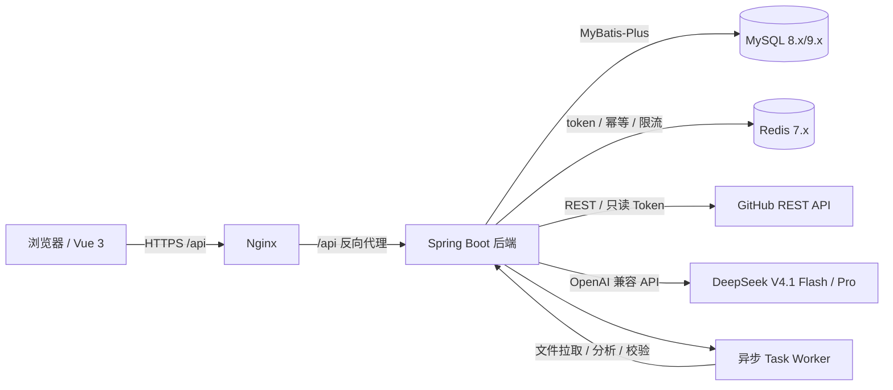
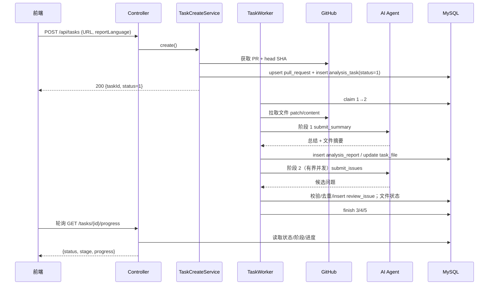
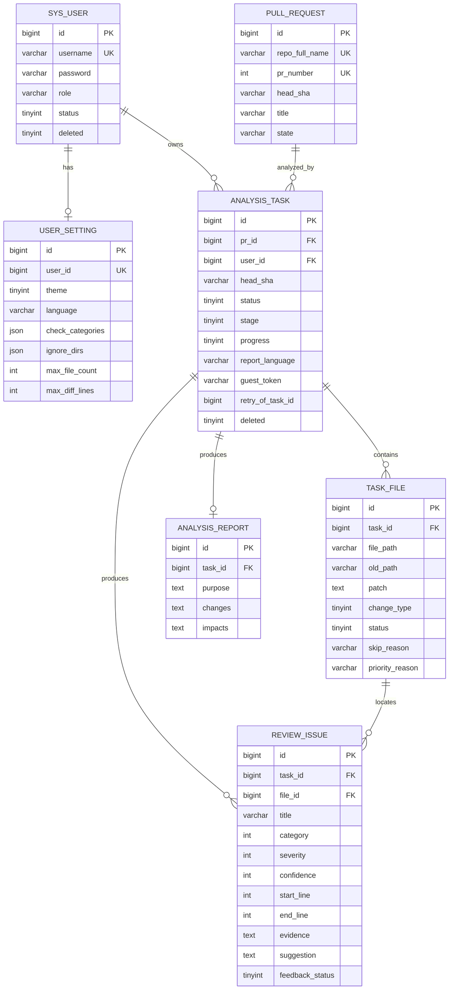
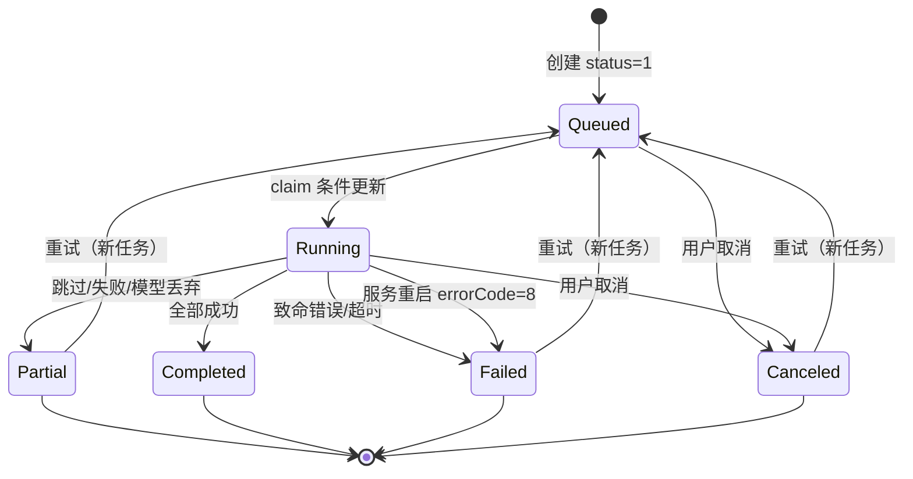
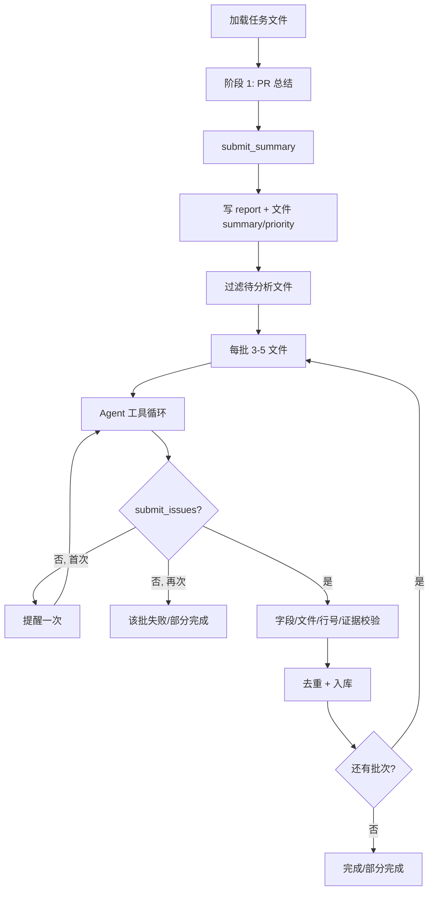
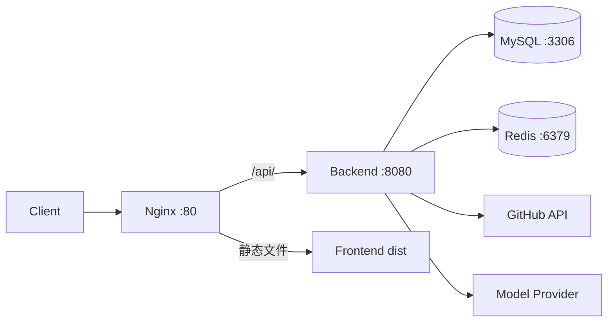

# 后端架构与数据图

> 可直接把 Mermaid 图导出到 PPT。实现基线 `master@d5e8ac3`。

## 1. 系统架构



## 2. 后端职责分层

```text
controller        HTTP 参数、鉴权入口、统一 Result
service          业务编排、事务、权限、任务创建/查询/导出
service.impl     业务实现
task             TaskWorker / TaskDispatcher / TaskRecoveryRunner
analysis         两阶段 AI pipeline、agent、工具、上下文、校验
integration      GitHub / 模型协议客户端及 DTO
mapper           MyBatis-Plus BaseMapper + XML 复杂查询
entity           analysis_task / task_file / review_issue 等
dto / vo         入参 / 出参
properties       AiProperties / GitHubProperties / PrAppProperties / TaskProperties
exception        业务、任务取消、模型、GitHub、Agent 异常
handler           GlobalExceptionHandler
filter            TraceIdFilter
logging           日志脱敏 / logback 布局
utils             PatchLineIndex / PatchDiffParser / URL / 语言检测
constant/context/result  枚举、用户上下文、统一响应
config           Sa-Token、MyBatis-Plus、线程池、Swagger、MVC
```

## 3. 请求与任务时序



## 4. ER 图



## 5. 任务状态机



## 6. AI 两阶段流程



## 7. 部署拓扑



- MySQL/Redis 只在 Compose 内部网络，不映射宿主端口。
- TLS 由外部负载均衡或 Nginx 终止。
- 日志：`backend-logs` 卷；MySQL/Redis 数据独立卷。

## 8. 关键代码位置

| 主题 | 类 |
| --- | --- |
| 任务创建/重试/取消 | `service.TaskCreateService`、`service.TaskLifecycleService` |
| 调度/执行/恢复 | `task.TaskDispatcher`、`task.TaskWorker`、`task.TaskRecoveryRunner` |
| 两阶段 AI | `analysis.DeepSeekAnalysisPipeline` |
| Agent 循环/工具 | `analysis.AgentExecutor`、`analysis.AgentToolRegistry`、`analysis.AgentToolDefinitions` |
| 上下文 | `analysis.ContextBuilder`、`analysis.TypeScriptContextExtractor`、`analysis.PythonContextExtractor` |
| 校验/降噪 | `analysis.IssueValidationService`、`utils.PatchLineIndex` |
| 结构化 Diff | `utils.PatchDiffParser`、`vo.TaskFileDiffVO` |
| 版本对比 | `service.TaskCompareService` |
| 权限/游客 | `service.TaskAccessService` |
| 日志/异常 | `logging.LogSanitizer`、`filter.TraceIdFilter`、`handler.GlobalExceptionHandler` |
