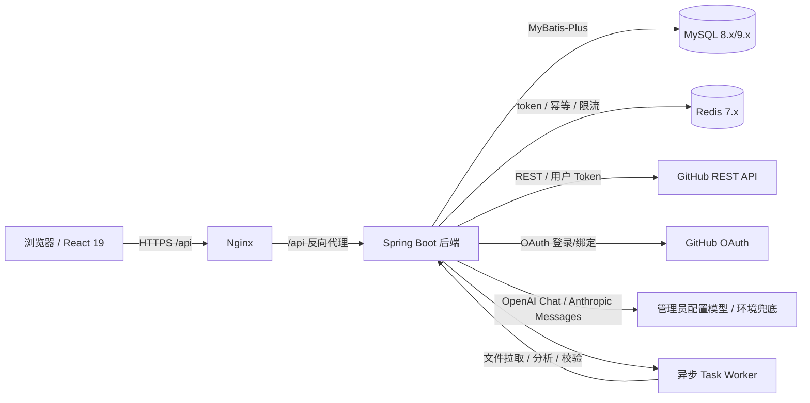
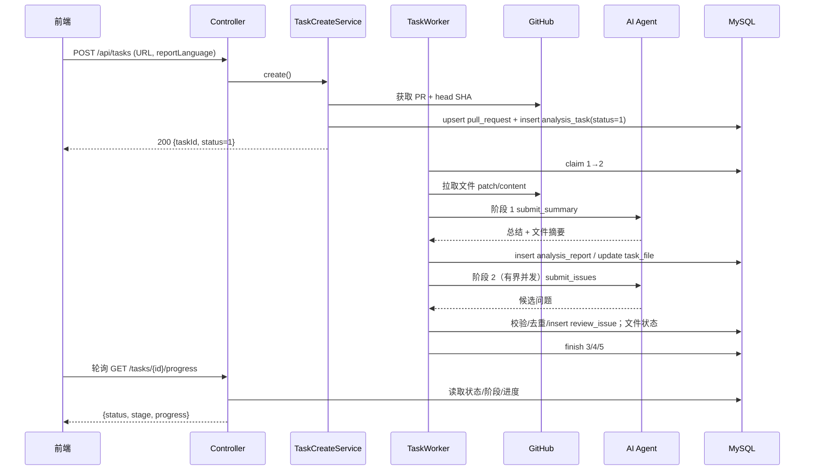
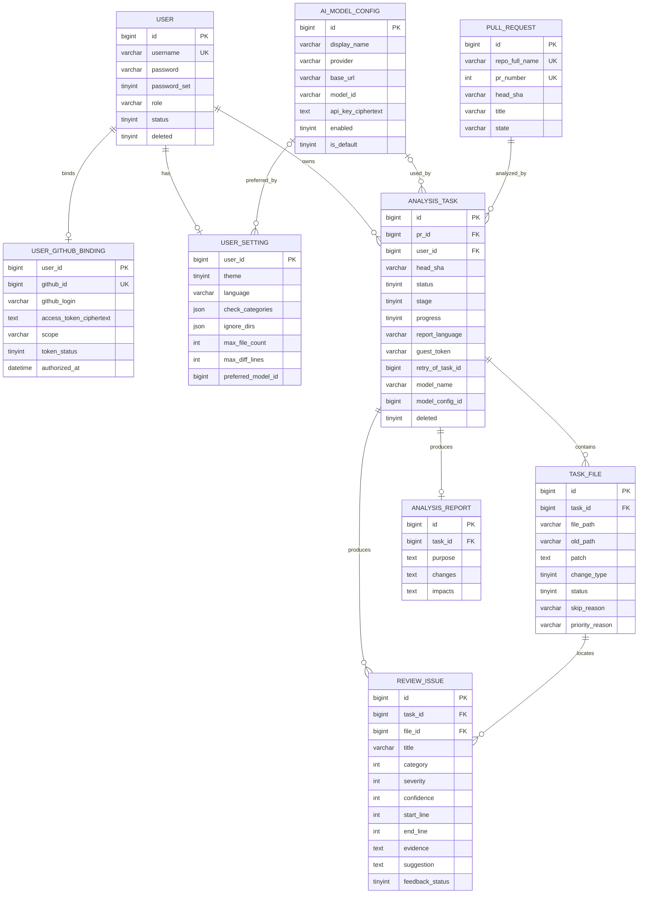
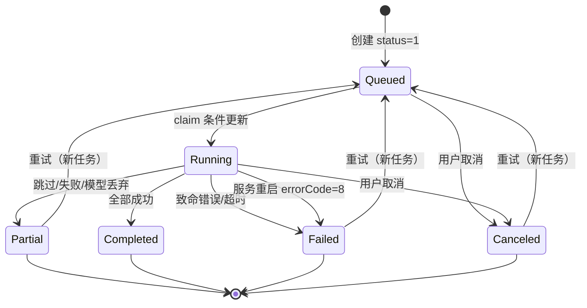
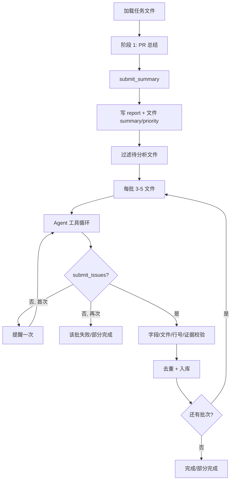
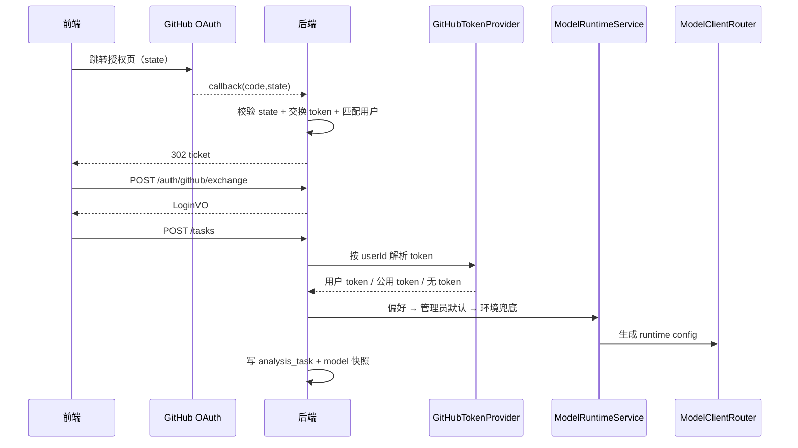
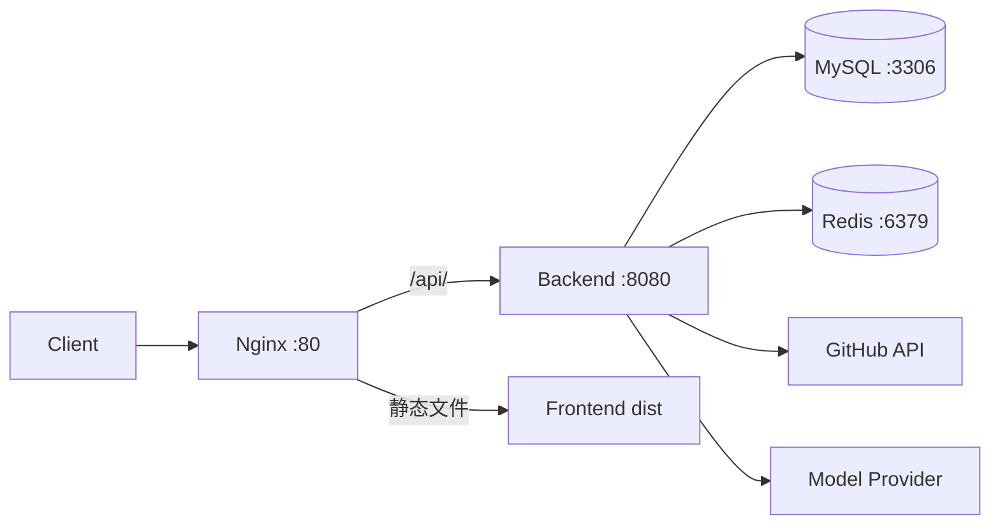

# 后端架构与数据图

> 可直接把 Mermaid 图导出到 PPT。实现基线：`backend-dev` 最新提交（2026-10-30）。

## 1. 系统架构



## 2. 后端职责分层

```text
controller        HTTP 参数、鉴权入口、统一 Result
service          业务接口：业务编排、事务、权限、任务创建/查询/导出
service.impl      业务实现
task             TaskWorker / TaskDispatcher / TaskRecoveryRunner
core.analysis    两阶段 AI pipeline、工具循环、上下文、校验
core.agent       Agent 执行器、工具定义
core.agent.ai    OpenAI/Anthropic 客户端、ModelClientRouter、fake
core.github      GitHub REST 客户端、URL 解析、错误映射和 DTO
core.github.oauth GitHub OAuth 客户端、state/ticket 载荷
mapper           MyBatis-Plus BaseMapper + XML 复杂查询
pojo.entity      analysis_task / task_file / review_issue / user_github_binding / ai_model_config 等
pojo.dto / vo    入参 / 出参
common.crypto     AES-GCM 敏感数据加密
common.properties AiProperties / GitHubProperties / GitHubOAuthProperties / SecurityProperties 等
common.exception    业务、任务取消、模型、GitHub、Agent 异常与全局处理器
common.logging      TraceIdFilter / 日志脱敏 / logback 布局
common.util         PatchLineIndex / PatchDiffParser / URL / 语言检测
common.cache        CacheNames / LogicalCacheService
common.constant/context/result  枚举、用户上下文、统一响应
config           Sa-Token、MyBatis-Plus、线程池、缓存、Swagger、MVC
```

## 3. 请求与任务时序



## 4. ER 图



## 5. 任务状态机



## 6. AI 两阶段流程



## 6.1 身份与模型解析时序



- GitHub token/模型 Key 只在服务端解密；任务只保存 user_id/model_config_id 和快照。
- 已绑定用户 token 失效不回退公用 token；模型停用回退默认/环境，历史任务保留原快照。

## 7. 部署拓扑



- MySQL/Redis 只在 Compose 内部网络，不映射宿主端口。
- TLS 由外部负载均衡或 Nginx 终止。
- GitHub OAuth 回调必须与 `PR_GITHUB_OAUTH_CALLBACK_URL` 一致；`PR_SECURITY_ENCRYPTION_KEY` 用于 GitHub token/模型 Key 加密。
- 模型可走管理员 `ai_model_config`，也可用 `PR_AI_PROVIDER=deepseek/fake` 环境兜底；生产保持 `PR_AI_ALLOW_PRIVATE_BASE_URL=false`。
- 日志：`backend-logs` 卷；MySQL/Redis 数据独立卷。

## 8. 关键代码位置

| 主题 | 类 |
| --- | --- |
| 任务创建/重试/取消 | `service.TaskCreateService`、`service.TaskLifecycleService` |
| 调度/执行/恢复 | `task.TaskDispatcher`、`task.TaskWorker`、`task.TaskRecoveryRunner` |
| 两阶段 AI | `core.analysis.DeepSeekAnalysisPipeline` |
| 模型路由 | `core.agent.ai.ModelClientRouter`、`OpenAiChatModelClient`、`AnthropicMessagesModelClient` |
| GitHub 身份 | `controller.auth.GitHubOAuthController`、`core.github.oauth.GitHubOAuthClient`、`service.impl.GitHubOAuthServiceImpl` |
| 用户 Token | `service.GitHubTokenProvider`、`core.github.GitHubAuth`、`service.impl.GitHubTokenProviderImpl` |
| 模型配置/偏好 | `service.ModelConfigService`、`service.ModelRuntimeService`、`controller.admin.AiModelConfigController` |
| 加密 | `common.crypto.AesGcmSecretCipher` |
| Agent 循环/工具 | `core.agent.AgentExecutor`、`core.agent.AgentToolRegistry`、`core.agent.AgentToolDefinitions` |
| 上下文 | `core.analysis.ContextBuilder`、`core.analysis.TypeScriptContextExtractor`、`core.analysis.PythonContextExtractor` |
| 校验/降噪 | `core.analysis.IssueValidationService`、`common.util.PatchLineIndex` |
| 结构化 Diff | `common.util.PatchDiffParser`、`pojo.vo.TaskFileDiffVO` |
| 版本对比 | `service.TaskCompareService` |
| 权限/游客 | `service.TaskAccessService` |
| 日志/异常 | `common.logging.LogSanitizer`、`common.logging.TraceIdFilter`、`common.exception.GlobalExceptionHandler` |
